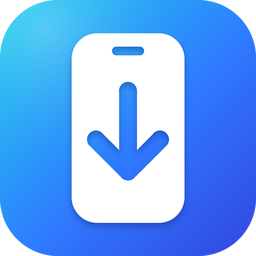
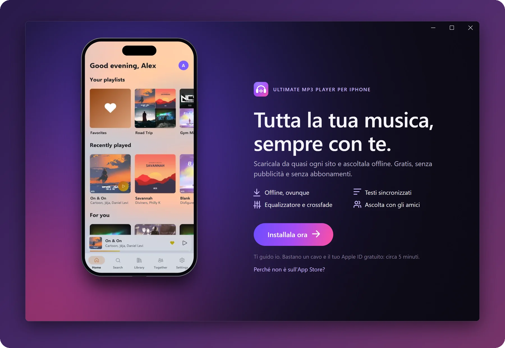
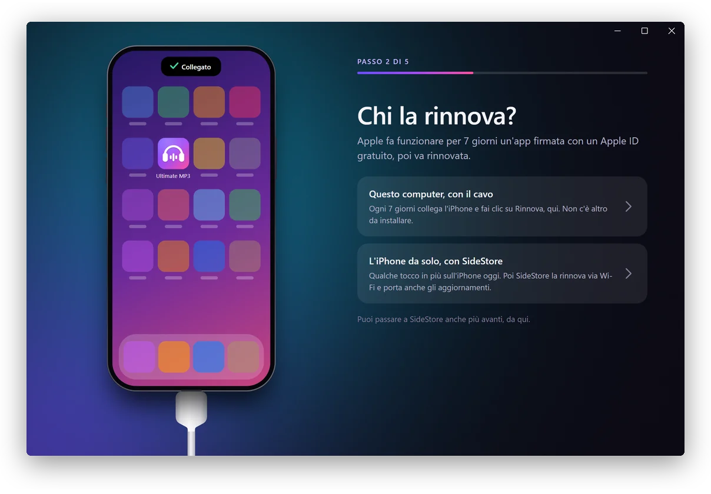
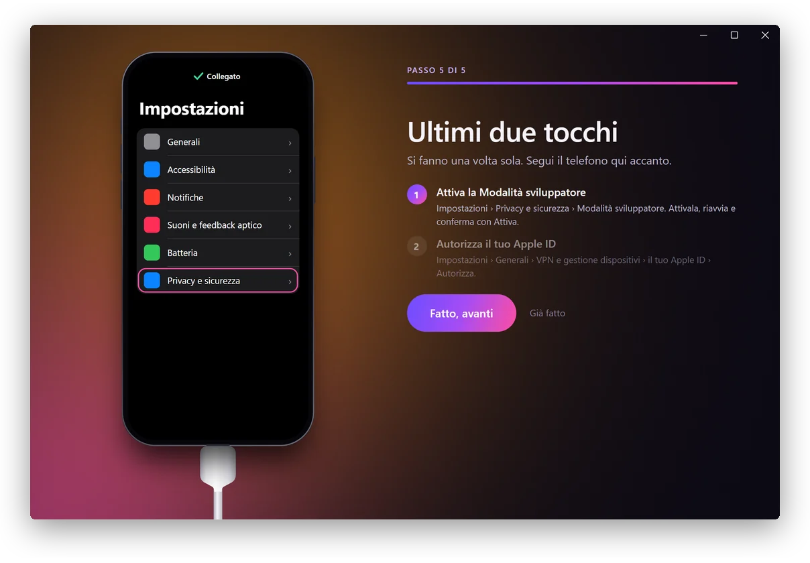
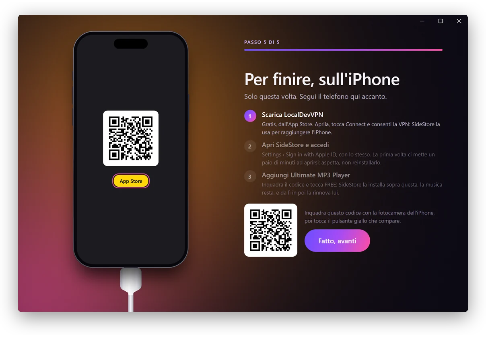
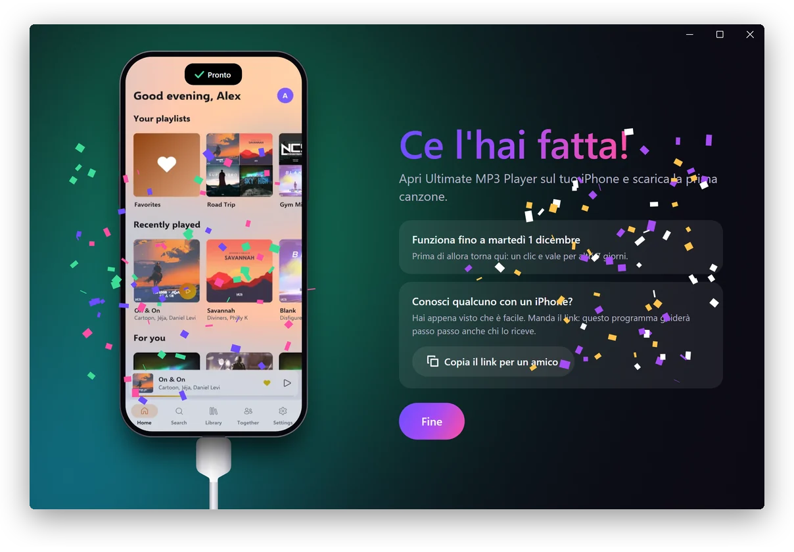

<p align="center">
  
</p>

<h1 align="center">Ultimate MP3 Player Installer</h1>

<p align="center">
  <b>L'app di musica che non può stare sull'App Store, sul tuo iPhone.</b><br>
  Collega il cavo e accedi con il tuo Apple ID gratuito:<br>
  al resto pensa questo programma, e ti mostra esattamente cosa toccare sul telefono.
</p>

<p align="center">
  <a href="https://github.com/KirboHQ/UltimateMP3Player-Installer-Tool/releases/latest/download/UltimateMP3Player-Installer-windows-x64-setup.exe"></a>
  <a href="https://github.com/KirboHQ/UltimateMP3Player-Installer-Tool/releases/latest/download/UltimateMP3Player-Installer-macos-arm64.zip"></a>
  <a href="https://github.com/KirboHQ/UltimateMP3Player-Installer-Tool/releases/latest/download/UltimateMP3Player-Installer-linux-x64.tar.gz"></a>
</p>

<p align="center">
  <a href="https://github.com/KirboHQ/UltimateMP3Player-Installer-Tool/releases/latest"></a>
  <a href="https://github.com/KirboHQ/UltimateMP3Player-Installer-Tool/releases"></a>
  <a href="LICENSE"></a>
  <a href="https://github.com/sponsors/KirboHQ"></a>
</p>

<p align="center"><a href="README.md">English</a> · <b>Italiano</b></p>



## ✨ Cosa fa

- 🪄 **Una finestra, tutti i passaggi**: prende da solo quello che serve al computer e, quando serve il tuo aiuto, un
  iPhone disegnato mostra esattamente cosa toccare.
- 🎵 **Sempre l'ultimo [Ultimate MP3 Player](https://github.com/KirboHQ/UltimateMP3Player)**, direttamente dalla sua
  ultima release.
- 🆓 **Gratis**, con il tuo Apple ID: niente account sviluppatore a pagamento, niente Mac, niente jailbreak.
- 🔄 **Rinnovata come preferisci**: un clic qui ogni 7 giorni, oppure dall'iPhone da solo con
  [SideStore](https://sidestore.io), che il programma prepara per te.
- 💾 **La tua musica resta**: rinnovi e aggiornamenti lasciano brani e playlist dove sono.
- ⬆️ **Si aggiorna da solo**: una nuova versione di questo programma si scarica in sottofondo e si installa quando lo chiudi.
- 🧹 **Non lascia niente in giro**: un pulsante toglie tutto quello che ha messo sul computer, e su Windows lo fa anche la
  disinstallazione.

<table>
  <tr>
    <td width="50%"></td>
    <td width="50%"></td>
  </tr>
  <tr>
    <td width="50%"></td>
    <td width="50%"></td>
  </tr>
</table>

<sub>Profilo e musica di prova di <a href="https://ncs.io">NoCopyrightSounds</a>. Ogni passaggio è disegnato sull'iPhone
accanto al testo, in italiano o in inglese, come la lingua del computer.</sub>

## 📥 Installazione

<table>
  <tr>
    <th>Sistema</th>
    <th>Scarica</th>
    <th>Buono a sapersi</th>
  </tr>
  <tr>
    <td><b>Windows</b><br><sub>10 (2004 o successiva) e 11</sub></td>
    <td><a href="https://github.com/KirboHQ/UltimateMP3Player-Installer-Tool/releases/latest/download/UltimateMP3Player-Installer-windows-x64-setup.exe"></a></td>
    <td><sub>Chiede l'app <b>Dispositivi Apple</b> di Apple e ti ci porta. Funziona anche sui PC ARM.</sub></td>
  </tr>
  <tr>
    <td><b>macOS</b><br><sub>Apple Silicon</sub></td>
    <td><a href="https://github.com/KirboHQ/UltimateMP3Player-Installer-Tool/releases/latest/download/UltimateMP3Player-Installer-macos-arm64.zip"></a></td>
    <td><sub>Nient'altro: quello che parla con l'iPhone è già in macOS.</sub></td>
  </tr>
  <tr>
    <td><b>Linux</b><br><sub>qualsiasi distribuzione recente</sub></td>
    <td><a href="https://github.com/KirboHQ/UltimateMP3Player-Installer-Tool/releases/latest/download/UltimateMP3Player-Installer-linux-x64.tar.gz"></a></td>
    <td><sub>Serve il pacchetto <code>usbmuxd</code>; se manca te lo dice lui.</sub></td>
  </tr>
</table>

Serve anche un iPhone o iPad con iOS 15 o successivo, il suo cavo e un Apple ID gratuito. Nessuno dei file è firmato con
un certificato a pagamento, quindi la prima volta il sistema potrebbe avvisarti:

<details>
<summary><b>Windows</b></summary>
<br>

Avvia il setup: niente diritti di amministratore, e un'icona da cui tornare per i rinnovi. Se SmartScreen dice che non è
riconosciuto, fai clic su **Ulteriori informazioni → Esegui comunque**. Lungo la strada il programma chiede una cosa, e
ti ci porta: l'app **Dispositivi Apple** dal Microsoft Store (è lei che parla con il telefono). Deve essere in funzione
perché l'iPhone venga visto, e se non lo è il programma la apre da solo. Se arrivi dalla versione 1.0, toglie il piccolo
Linux che aveva creato in WSL e, se WSL resta vuoto, chiede se disattivare anche quello.
</details>

<details>
<summary><b>macOS</b></summary>
<br>

Trascinalo dallo zip in *Applicazioni*. La prima volta apri **Impostazioni di Sistema → Privacy e sicurezza** e fai clic su
**Apri comunque**. Se macOS dice che l'app "è danneggiata", esegui una volta nel Terminale:
`xattr -dr com.apple.quarantine "/Applications/Ultimate MP3 Player Installer.app"`
</details>

<details>
<summary><b>Linux</b></summary>
<br>

Installa `usbmuxd` (il pacchetto si chiama così quasi ovunque), poi estrai il programma in una cartella tua (lì si aggiorna
da solo) e avvialo:

```sh
mkdir -p ~/.local/opt
tar -xzf UltimateMP3Player-Installer-linux-x64.tar.gz -C ~/.local/opt
~/.local/opt/UltimateMP3Player-Installer/UltimateMP3PlayerInstaller
```
</details>

## 📱 Sull'iPhone, la prima volta

Il programma mostra ognuno di questi passaggi sull'iPhone disegnato, al momento giusto; eccoli comunque. Si fanno una
volta sola per iPhone.

1. **Autorizza il computer**: quando colleghi il cavo, sblocca l'iPhone, tocca **Autorizza** e inserisci il codice.
2. **Attiva la Modalità sviluppatore** (iOS 16 o successivo): dopo la prima installazione apri *Impostazioni › Privacy e
   sicurezza › Modalità sviluppatore* e attivala. L'iPhone si riavvia; una volta sbloccato, conferma con **Attiva**.
   (L'opzione compare solo quando sul telefono c'è già un'app come questa.)
3. **Autorizza il tuo Apple ID**: *Impostazioni › Generali › VPN e gestione dispositivi*, tocca il tuo Apple ID, poi
   **Autorizza**.

Poi apri Ultimate MP3 Player.

## 💡 Buono a sapersi

- 📅 **7 giorni.** Un'app firmata con un Apple ID gratuito funziona per 7 giorni. Prima che finiscano, collega il cavo e
  premi **Rinnova**: un clic, e musica e playlist restano dove sono. Le nuove versioni dell'app arrivano allo stesso modo.
- 📲 **Oppure SideStore**, se lo scegli dopo aver collegato l'iPhone (o più avanti, dalla pagina iniziale del programma):
  rinnova l'app sul telefono, via Wi-Fi con [LocalDevVPN](https://apps.apple.com/app/id6755608044) collegata, e porta
  anche le nuove versioni. Il programma lo installa e ti mostra i tre tocchi che servono (il primo accesso in SideStore può
  metterci un paio di minuti ad aprirsi: aspetta e basta); poi apri SideStore ogni tanto. Se un giorno smette,
  **Ripara SideStore** nel programma lo rimette a posto con il cavo.
- 🔒 **La tua password** va direttamente ad Apple e non viene conservata: sul computer resta un token di accesso, finché
  non esci. Apple vuole anche la prova che il login arrivi da un dispositivo Apple: per questo un servizio esterno crea
  un'identità casuale, senza mai vedere la tua email o la tua password. Per una sicurezza in più, crea un secondo Apple ID
  gratuito solo per questo.
- 🍎 **I limiti di Apple** per un Apple ID gratuito: 3 app di questo tipo alla volta (SideStore è una di queste) e 10 nuove
  a settimana.

## ❤️ Sostieni il progetto

Ultimate MP3 Player e questo installer sono gratuiti, senza pubblicità, e fatti nel tempo libero. Se ti piacciono, puoi
sostenerli su [GitHub Sponsors](https://github.com/sponsors/KirboHQ) o [Ko-fi](https://ko-fi.com/kirbohq).

Qualcosa non ha funzionato? Se è l'accesso, guarda prima la [pagina di stato di Apple](https://www.apple.com/it/support/systemstatus/)
(*Account e Accesso iCloud*): ogni tanto l'accesso di Apple non funziona per nessuno, e il programma ti ci porta.
Altrimenti [raccontamelo](https://github.com/KirboHQ/UltimateMP3Player-Installer-Tool/issues/new): il pulsante
**Dettagli** del programma ti dà il testo da incollare (email e identificativo del telefono sono già nascosti).

## 🛠️ Per sviluppatori

<details>
<summary>Come funziona, e come compilarlo</summary>
<br>

Un piccolo aiutante che arriva con il programma ([helper](helper), Rust) firma l'app con
[isideload](https://github.com/nab138/isideload) e la mette sul telefono con [idevice](https://github.com/jkcoxson/idevice);
questo programma (C#, [Avalonia](https://avaloniaui.net)) lo guida e spiega cosa sta succedendo. Raggiunge il telefono
attraverso il servizio di Apple: Dispositivi Apple su Windows, già dentro macOS, `usbmuxd` su Linux. Scarica solo l'app,
e SideStore se lo scegli: una versione fissata e controllata con il suo hash.

Per compilarlo (.NET 10 SDK e Rust): `cargo build --release` in `helper`, poi `dotnet run --project src/Installer`.
I controlli e tutte le schermate: `tests/Shots`. Pacchetti: [release.yml](.github/workflows/release.yml).
</details>

## 📄 Licenza

Software libero sotto la [GNU General Public License v3.0](LICENSE). Cosa c'è dentro e cosa scarica, ognuno con la sua
licenza: [licenses](licenses).
