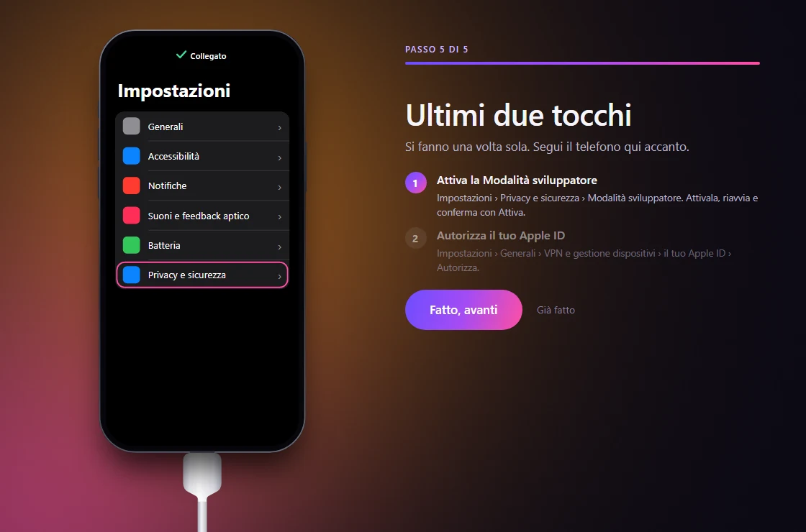
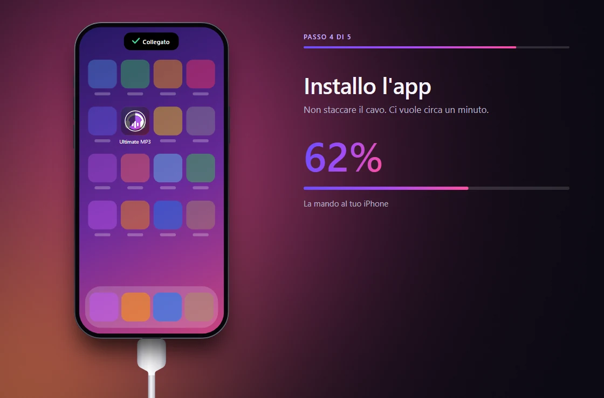
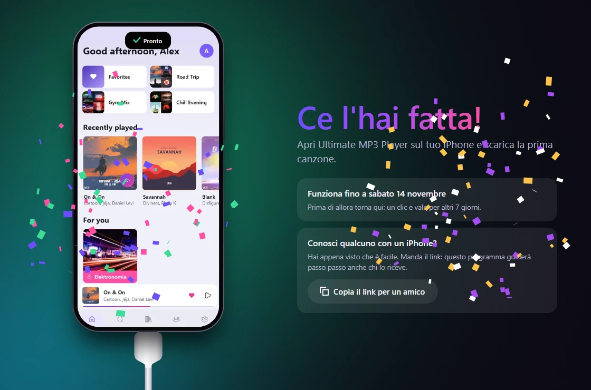

<p align="center">
  
</p>

<h1 align="center">Ultimate MP3 Player Installer</h1>

<p align="center">
  <b>L'app di musica che non può stare sull'App Store, sul tuo iPhone.</b><br>
  Collega il cavo, accedi con il tuo Apple ID: al resto pensa questo programma,<br>
  e ti mostra esattamente cosa toccare sul telefono.
</p>

<p align="center">
  <a href="https://github.com/KirboHQ/UltimateMP3Player-Installer-Tool/releases/latest/download/UltimateMP3Player-Installer-windows-x64-setup.exe"></a>
  <a href="https://github.com/KirboHQ/UltimateMP3Player-Installer-Tool/releases/latest/download/UltimateMP3Player-Installer-macos-arm64.zip"></a>
  <a href="https://github.com/KirboHQ/UltimateMP3Player-Installer-Tool/releases/latest/download/UltimateMP3Player-Installer-linux-x64.tar.gz"></a>
</p>

<p align="center"><a href="README.md">English</a> · <b>Italiano</b></p>


<table>
  <tr>
    <td></td>
    <td></td>
    <td></td>
  </tr>
</table>

## Cosa fa

- **Una finestra, tutti i passaggi.** Prende da solo quello che serve al computer; quando serve il tuo aiuto, un iPhone disegnato mostra cosa toccare.
- **Sempre l'ultima versione** di [Ultimate MP3 Player](https://github.com/KirboHQ/UltimateMP3Player), dalla sua ultima release.
- **Gratis**, con il tuo Apple ID: niente account sviluppatore a pagamento, niente Mac obbligatorio, niente jailbreak.
- **Non lascia niente in giro**: un pulsante toglie tutto quello che ha messo sul computer, e su Windows lo fa anche la disinstallazione.

## Cosa serve

- Un iPhone o iPad con iOS 15 o successivo, e il suo cavo.
- Un Apple ID gratuito.
- Un computer: Windows 10 (versione 2004 o successiva) o 11, macOS su Apple Silicon, oppure Linux.

<details>
<summary><b>Windows</b></summary>
<br>

Avvia il setup: niente diritti di amministratore, e un'icona da cui tornare per i rinnovi. Se SmartScreen dice che non è
riconosciuto, fai clic su **Ulteriori informazioni → Esegui comunque**: non è firmato con un certificato a pagamento. Lungo
la strada il programma chiede due cose, e ti porta a ognuna: l'app **Dispositivi Apple** dal Microsoft Store (è lei che
parla con il telefono) e **WSL**, il modo di Windows per far girare Linux (una finestra di autorizzazione; se serve
riavviare, il programma si riapre da solo e continua).
</details>

<details>
<summary><b>macOS</b></summary>
<br>

Trascinalo dallo zip in *Applicazioni*. La prima volta apri **Impostazioni di Sistema → Privacy e sicurezza** e fai clic su
**Apri comunque**. Se macOS dice che l'app "è danneggiata", esegui una volta nel Terminale:
`xattr -dr com.apple.quarantine "/Applications/Ultimate MP3 Player Installer.app"`
</details>

<details>
<summary><b>Linux</b></summary>
<br>

Serve `usbmuxd` (il pacchetto si chiama così quasi ovunque), e te lo dice lui se manca:

```sh
tar -xzf UltimateMP3Player-Installer-linux-x64.tar.gz
./UltimateMP3Player-Installer/UltimateMP3PlayerInstaller
```
</details>

## Buono a sapersi

- **7 giorni.** Un'app firmata con un Apple ID gratuito funziona per 7 giorni. Prima che finiscano, collega il cavo e premi
  **Rinnova**: un clic, e musica e playlist restano dove sono. Le nuove versioni dell'app arrivano allo stesso modo.
- **La tua password** va direttamente ad Apple e non viene conservata: sul computer resta un token di accesso, finché non
  esci. Apple vuole anche la prova che il login arrivi da un dispositivo Apple: per questo un servizio esterno crea
  un'identità casuale, senza mai vedere la tua email o la tua password. Per una sicurezza in più, crea un secondo Apple ID
  gratuito solo per questo.
- **I limiti di Apple** per un Apple ID gratuito: 3 app di questo tipo alla volta e 10 nuove a settimana.

Qualcosa non ha funzionato? [Raccontamelo](https://github.com/KirboHQ/UltimateMP3Player-Installer-Tool/issues/new): il
pulsante **Dettagli** del programma ti dà il testo da incollare (email e identificativo del telefono sono già nascosti).

## Come funziona

[xtool](https://github.com/xtool-org/xtool) firma l'app e la mette sul telefono; questo programma lo guida e spiega cosa
sta succedendo. Su Windows xtool gira in un piccolo Linux tutto suo dentro WSL, separato da qualsiasi cosa tua, e raggiunge
il telefono attraverso Dispositivi Apple. Ogni motore scaricato è una versione fissata e controllata con il suo hash.

Per compilarlo (.NET 10 SDK): `dotnet run --project src/Installer`. Pacchetti: [release.yml](.github/workflows/release.yml).

## Licenza

[GPL-3.0](LICENSE). Cosa c'è dentro e cosa scarica, ognuno con la sua licenza: [licenses](licenses).
