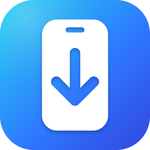
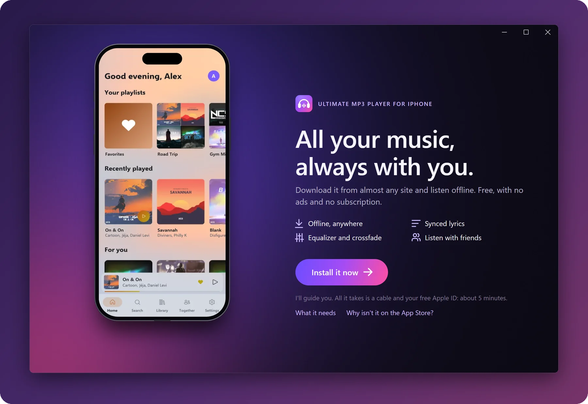
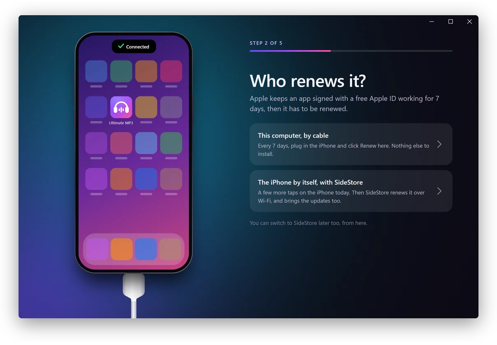
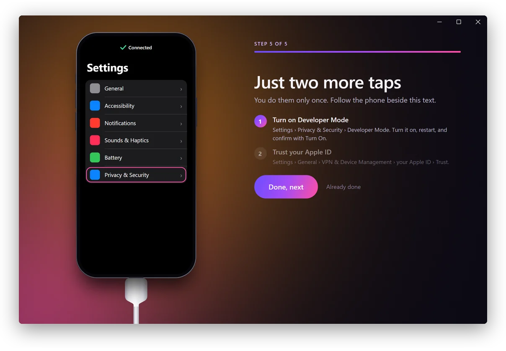
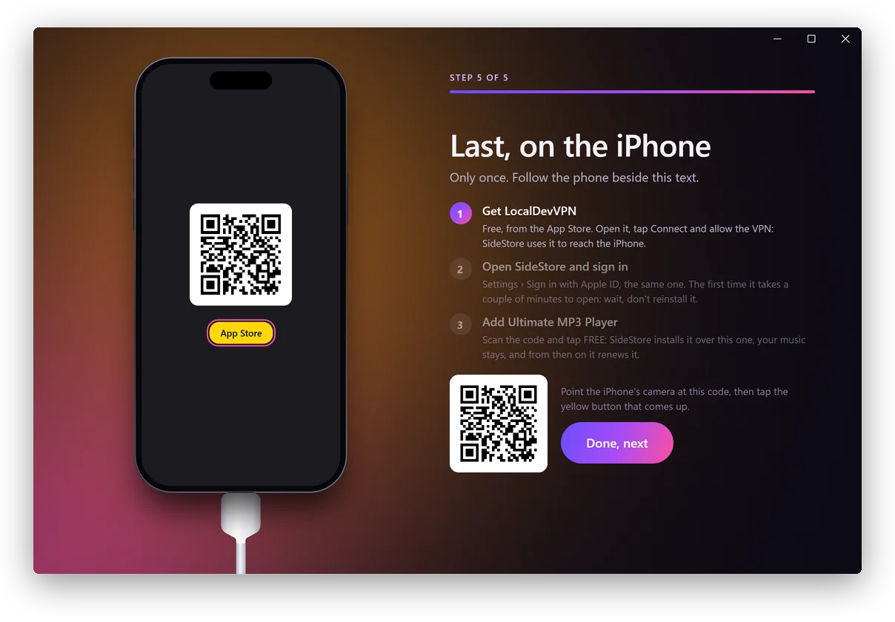
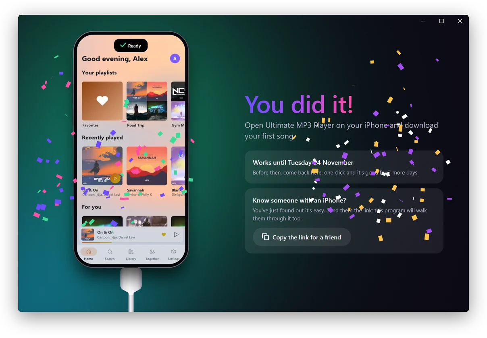

<p align="center">
  
</p>

<h1 align="center">Ultimate MP3 Player Installer</h1>

<p align="center">
  <b>The music app that can't be on the App Store, on your iPhone.</b><br>
  Plug in the cable and sign in with your free Apple ID:<br>
  this program does the rest, and shows you exactly what to tap on your phone.
</p>

<p align="center">
  <a href="https://github.com/KirboHQ/UltimateMP3Player-Installer-Tool/releases/latest/download/UltimateMP3Player-Installer-windows-x64-setup.exe"></a>
  <a href="https://github.com/KirboHQ/UltimateMP3Player-Installer-Tool/releases/latest/download/UltimateMP3Player-Installer-macos-arm64.zip"></a>
  <a href="https://github.com/KirboHQ/UltimateMP3Player-Installer-Tool/releases/latest/download/UltimateMP3Player-Installer-linux-x64.tar.gz"></a>
</p>

<p align="center">
  <a href="https://github.com/KirboHQ/UltimateMP3Player-Installer-Tool/releases/latest"></a>
  <a href="https://github.com/KirboHQ/UltimateMP3Player-Installer-Tool/releases"></a>
  <a href="LICENSE"></a>
  <a href="https://github.com/sponsors/KirboHQ"></a>
</p>

<p align="center"><b>English</b> · <a href="README.it.md">Italiano</a></p>



## ✨ What it does

- 🪄 **One window, every step**: it gets what the computer needs by itself, and when it needs you, a drawn iPhone shows
  exactly what to tap.
- 🎵 **Always the newest [Ultimate MP3 Player](https://github.com/KirboHQ/UltimateMP3Player)**, straight from its latest
  release.
- 🆓 **Free**, with your own Apple ID: no paid developer account, no Mac needed, no jailbreak.
- 🔄 **Renewed your way**: one click here every 7 days, or by the iPhone itself with [SideStore](https://sidestore.io),
  which the program sets up for you.
- 💾 **Your music stays**: renewing or updating keeps your songs and playlists where they are.
- ⬆️ **Keeps itself up to date**: a new version of this program downloads in the background and goes in when you close it.
- 🧹 **Nothing left behind**: one button removes everything it put on the computer, and on Windows so does uninstalling it.

<table>
  <tr>
    <td width="50%"></td>
    <td width="50%"></td>
  </tr>
  <tr>
    <td width="50%"></td>
    <td width="50%"></td>
  </tr>
</table>

<sub>Demo profile and music by <a href="https://ncs.io">NoCopyrightSounds</a>. Every step is drawn on the iPhone beside
the text, in English or Italian, as your computer speaks.</sub>

## 📥 Install

<table>
  <tr>
    <th>System</th>
    <th>Download</th>
    <th>Good to know</th>
  </tr>
  <tr>
    <td><b>Windows</b><br><sub>10 (2004 or later) and 11</sub></td>
    <td><a href="https://github.com/KirboHQ/UltimateMP3Player-Installer-Tool/releases/latest/download/UltimateMP3Player-Installer-windows-x64-setup.exe"></a></td>
    <td><sub>It asks for Apple's <b>Apple Devices</b> app and takes you to it. Runs on ARM PCs too.</sub></td>
  </tr>
  <tr>
    <td><b>macOS</b><br><sub>Apple Silicon</sub></td>
    <td><a href="https://github.com/KirboHQ/UltimateMP3Player-Installer-Tool/releases/latest/download/UltimateMP3Player-Installer-macos-arm64.zip"></a></td>
    <td><sub>Nothing else: what talks to the iPhone is already in macOS.</sub></td>
  </tr>
  <tr>
    <td><b>Linux</b><br><sub>any recent distribution</sub></td>
    <td><a href="https://github.com/KirboHQ/UltimateMP3Player-Installer-Tool/releases/latest/download/UltimateMP3Player-Installer-linux-x64.tar.gz"></a></td>
    <td><sub>Needs the <code>usbmuxd</code> package; it tells you if it's missing.</sub></td>
  </tr>
</table>

You also need an iPhone or iPad with iOS 15 or later, its cable, and a free Apple ID. None of the files is signed with a
paid certificate, so the system may warn you the first time:

<details>
<summary><b>Windows</b></summary>
<br>

Run the setup: no administrator rights, and an icon to come back to for the renewals. If SmartScreen says it's
unrecognized, click **More info → Run anyway**. Along the way the program asks for one thing, and takes you to it: the
**Apple Devices** app from the Microsoft Store (it's what talks to the phone). Its service has to be running for the iPhone to
be seen: the program starts it by itself when it isn't, in the background, and turns it off again when you close it. Coming from version 1.0, it removes the small Linux it had made
in WSL, and if WSL is left empty it asks whether to turn it off.
</details>

<details>
<summary><b>macOS</b></summary>
<br>

Drag it from the zip into *Applications*. The first time, open **System Settings → Privacy & Security** and click **Open
Anyway**. If macOS says the app "is damaged", run once in the Terminal:
`xattr -dr com.apple.quarantine "/Applications/Ultimate MP3 Player Installer.app"`
</details>

<details>
<summary><b>Linux</b></summary>
<br>

Install `usbmuxd` (the package has that name almost everywhere), then extract the program to a folder of yours (it updates
itself there) and start it:

```sh
mkdir -p ~/.local/opt
tar -xzf UltimateMP3Player-Installer-linux-x64.tar.gz -C ~/.local/opt
~/.local/opt/UltimateMP3Player-Installer/UltimateMP3PlayerInstaller
```
</details>

## 📱 On the iPhone, the first time

The program shows each of these on the drawn iPhone when it's time; here they are anyway. They're done once per iPhone.

1. **Trust this computer**: when you plug in the cable, unlock the iPhone, tap **Trust** and enter your passcode.
2. **Turn on Developer Mode** (iOS 16 or later): after the first install, open *Settings › Privacy & Security ›
   Developer Mode* and turn it on. The iPhone restarts; once it's unlocked, confirm with **Turn On**. (The option shows
   up only once an app like this one is on the phone.)
3. **Trust your Apple ID**: *Settings › General › VPN & Device Management*, tap your Apple ID, then **Trust**.

Then open Ultimate MP3 Player.

## 💡 Good to know

- 📅 **7 days.** Apple keeps an app signed with a free Apple ID working for 7 days. Before they end, plug in the cable and
  press **Renew**: one click, and your music and playlists stay where they are. New versions of the app arrive the same way.
- 📲 **Or SideStore**, if you choose it after plugging in the iPhone (or later, from the program's home page): it renews
  the app on the phone, over Wi-Fi with [LocalDevVPN](https://apps.apple.com/app/id6755608044) connected, and brings the
  new versions too. The program installs it and shows you the three taps it takes (the first sign-in in SideStore can
  take a couple of minutes to open: just wait); then open SideStore every few days. If it ever stops, **Repair SideStore**
  in the program sets it right by cable.
- 🔒 **Your password** goes straight to Apple, and isn't kept: what stays on the computer is a login token, until you sign
  out. Apple also wants proof that a login comes from an Apple device, so an outside service creates a random identity for
  it, which never sees your email or password. If you'd rather stay extra safe, create a second free Apple ID just for this.
- 🍎 **Apple's limits** on a free Apple ID: 3 apps of this kind at a time (SideStore is one of them), and 10 new ones a week.

## ❤️ Support the project

Ultimate MP3 Player and this installer are free, with no ads, and made in spare time. If you like them, you can support
them on [GitHub Sponsors](https://github.com/sponsors/KirboHQ) or [Ko-fi](https://ko-fi.com/kirbohq).

Something didn't work? If it's signing in, look at [Apple's status page](https://www.apple.com/support/systemstatus/)
first (*iCloud Account & Sign In*): every now and then Apple's sign-in is down for everyone, and the program takes you
there. Otherwise, [tell me about it](https://github.com/KirboHQ/UltimateMP3Player-Installer-Tool/issues/new): the
program's **Details** button gives you the text to paste (your email and your phone's id are already hidden).

## 🛠️ For developers

<details>
<summary>How it works, and how to build it</summary>
<br>

A small helper that comes with the program ([helper](helper), Rust) signs the app with
[isideload](https://github.com/nab138/isideload) and puts it on the phone with [idevice](https://github.com/jkcoxson/idevice);
this program (C#, [Avalonia](https://avaloniaui.net)) drives it and explains what's going on. It reaches the phone through
Apple's own service: Apple Devices on Windows, built into macOS, `usbmuxd` on Linux. It downloads only the app, and
SideStore if you choose it: a pinned version, checked against its hash.

To build it (.NET 10 SDK and Rust): `cargo build --release` in `helper`, then `dotnet run --project src/Installer`.
The checks and every screen: `tests/Shots`. Packages: [release.yml](.github/workflows/release.yml).
</details>

## 📄 License

Free software under the [GNU General Public License v3.0](LICENSE). What's inside and what it downloads, each with its own
license: [licenses](licenses).
