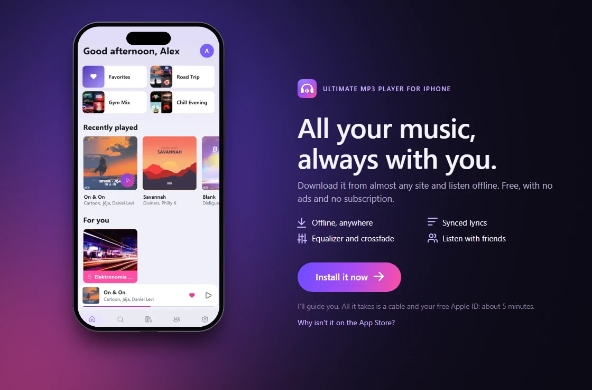
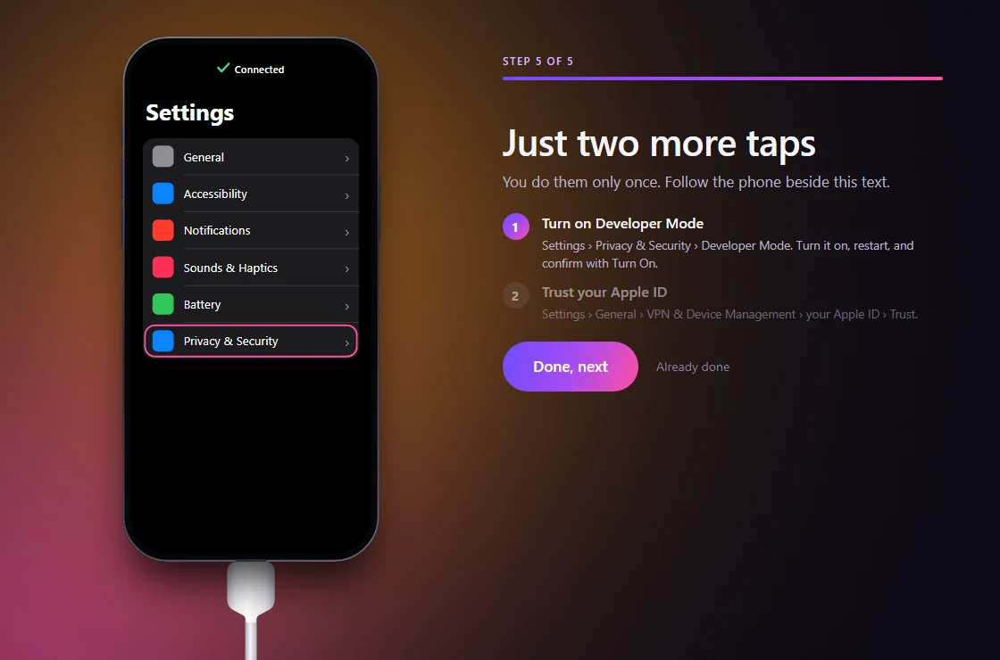
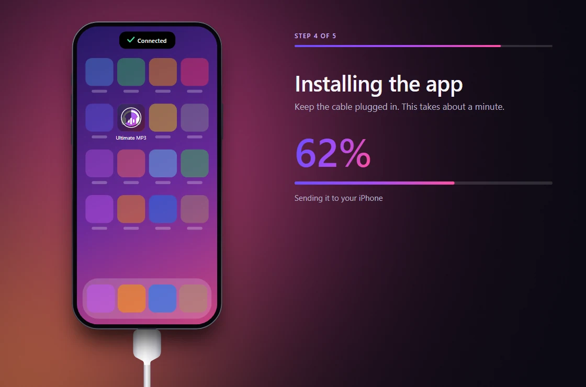
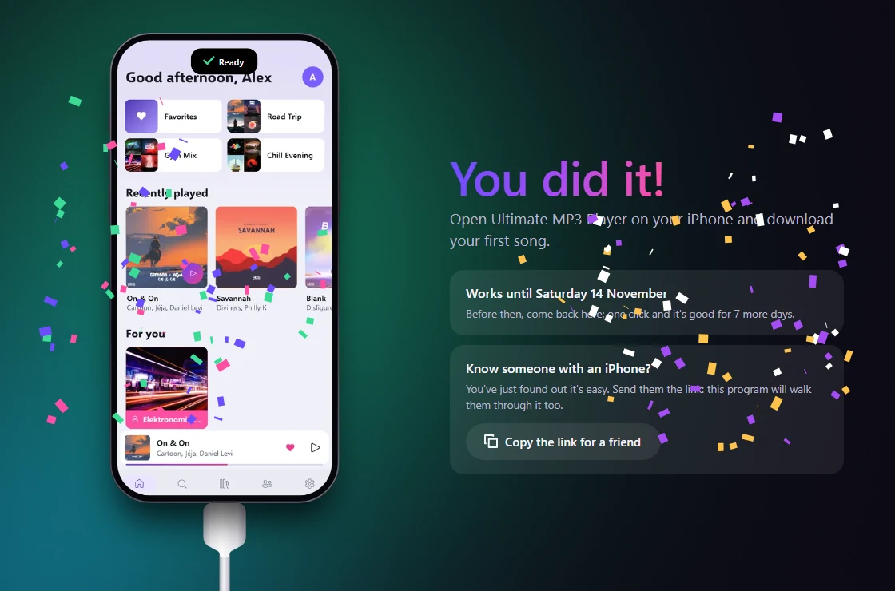

<p align="center">
  
</p>

<h1 align="center">Ultimate MP3 Player Installer</h1>

<p align="center">
  <b>The music app that can't be on the App Store, on your iPhone.</b><br>
  Plug in the cable, sign in with your Apple ID: this program does the rest,<br>
  and shows you exactly what to tap on your phone.
</p>

<p align="center">
  <a href="https://github.com/KirboHQ/UltimateMP3Player-Installer-Tool/releases/latest/download/UltimateMP3Player-Installer-windows-x64-setup.exe"></a>
  <a href="https://github.com/KirboHQ/UltimateMP3Player-Installer-Tool/releases/latest/download/UltimateMP3Player-Installer-macos-arm64.zip"></a>
  <a href="https://github.com/KirboHQ/UltimateMP3Player-Installer-Tool/releases/latest/download/UltimateMP3Player-Installer-linux-x64.tar.gz"></a>
</p>

<p align="center"><b>English</b> · <a href="README.it.md">Italiano</a></p>



<table>
  <tr>
    <td></td>
    <td></td>
    <td></td>
  </tr>
</table>

## What it does

- **One window, every step.** It gets what the computer needs by itself; when it needs you, a drawn iPhone shows what to tap.
- **Always the newest version** of [Ultimate MP3 Player](https://github.com/KirboHQ/UltimateMP3Player), from its latest release.
- **Free**, with your own Apple ID: no paid developer account, no Mac needed, no jailbreak.
- **Nothing left behind**: one button removes everything it put on the computer, and on Windows so does uninstalling it.

## What you need

- An iPhone or iPad with iOS 15 or later, and its cable.
- A free Apple ID.
- A computer: Windows 10 (version 2004 or later) or 11, macOS on Apple Silicon, or Linux.

<details>
<summary><b>Windows</b></summary>
<br>

Run the setup: no administrator rights, and an icon to come back to for the renewals. If SmartScreen says it's
unrecognized, click **More info → Run anyway**: it isn't signed with a paid certificate. Along the way the program asks for
two things, and takes you to each: the **Apple Devices** app from the Microsoft Store (it's what talks to the phone), and
**WSL**, Windows' own way of running Linux (one permission window; if a restart is needed, the program comes back by itself
and carries on).
</details>

<details>
<summary><b>macOS</b></summary>
<br>

Drag it from the zip into *Applications*. The first time, open **System Settings → Privacy & Security** and click **Open
Anyway**. If macOS says the app "is damaged", run once in the Terminal:
`xattr -dr com.apple.quarantine "/Applications/Ultimate MP3 Player Installer.app"`
</details>

<details>
<summary><b>Linux</b></summary>
<br>

It needs `usbmuxd` (the package has that name almost everywhere), and it tells you if it's missing:

```sh
tar -xzf UltimateMP3Player-Installer-linux-x64.tar.gz
./UltimateMP3Player-Installer/UltimateMP3PlayerInstaller
```
</details>

## Good to know

- **7 days.** Apple keeps an app signed with a free Apple ID working for 7 days. Before they end, plug in the cable and
  press **Renew**: one click, and your music and playlists stay where they are. New versions of the app arrive the same way.
- **Your password** goes straight to Apple, and isn't kept: what stays on the computer is a login token, until you sign
  out. Apple also wants proof that a login comes from an Apple device, so an outside service creates a random identity for
  it, which never sees your email or password. If you'd rather stay extra safe, create a second free Apple ID just for this.
- **Apple's limits** on a free Apple ID: 3 apps of this kind at a time, and 10 new ones a week.

Something didn't work? [Tell me about it](https://github.com/KirboHQ/UltimateMP3Player-Installer-Tool/issues/new): the
program's **Details** button gives you the text to paste (your email and your phone's id are already hidden).

## How it works

[xtool](https://github.com/xtool-org/xtool) signs the app and puts it on the phone; this program drives it and explains
what's going on. On Windows xtool runs in a small Linux of its own inside WSL, separate from anything of yours, reaching
the phone through Apple Devices. Every engine it downloads is a pinned version checked against its hash.

To build it (.NET 10 SDK): `dotnet run --project src/Installer`. Packages: [release.yml](.github/workflows/release.yml).

## License

[GPL-3.0](LICENSE). What's inside and what it downloads, each with its own license: [licenses](licenses).
